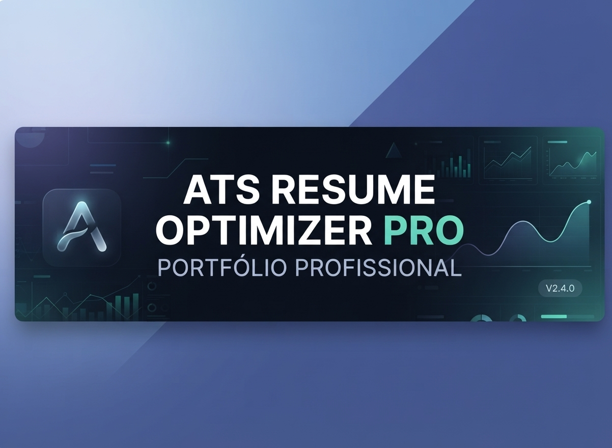

<p align="center">
  
</p>

<h1 align="center">🚀 ATS Resume Optimizer Pro</h1>

<p align="center">
  <b>Sistemas de Otimização de Currículos & Analisador de Compatibilidade ATS</b><br>
  <i>Projeto prático desenvolvido para o desafio técnico da plataforma DIO.</i>
</p>

<p align="center">
  
  
  
  
  
  
  
</p>

---

---

---

---

## 🎯 Sobre o Projeto

O **ATS Resume Optimizer Pro** é uma aplicação web corporativa criada para resolver um dos maiores desafios de candidatos no mercado de trabalho atual: a aprovação em **Sistemas de Rastreamento de Candidatos (ATS - Applicant Tracking Systems)**.

### 💡 Principais Funcionalidades
1. **Dashboard Executivo de Performance:** Painel visual com indicadores consolidados (*Match Rate*, total de análises realizadas e densidade de palavras-chave).
2. **Analisador de Compatibilidade em Tempo Real:**
   - Comparador side-by-side de duas colunas (Descrição da Vaga vs. Currículo do Candidato).
   - Realce de termos-chave encontrados (destaque verde) e lacunas pendentes (destaque vermelho/âmbar).
3. **Gerador Dinâmico de `.docx`:** Exportação instantânea e formatada diretamente no navegador via biblioteca `docx`.
4. **Governança e Ética Profissional:** Mecanismos de alerta e orientação reforçando que a ferramenta otimiza a apresentação sem falsificar qualificações.

---

---

---

---

## 🛠️ Engenharia de Contorno & Troubleshooting (Narrativa Técnica)

Durante o desenvolvimento deste desafio, identificou-se um impedimento de cota/créditos na plataforma inicial prevista.

Em alinhamento com a postura profissional, autônoma e resiliente exigida na engenharia de software moderna, aplicou-se a seguinte estratégia:
1. **Mapeamento da Restrição:** Isolamento do gargalo tecnológico na camada de infraestrutura inicial, mantendo intactos todos os requisitos funcionais e arquiteturais.
2. **Migração Paritária:** Execução limpa do Mega Prompt na engine de alta performance **v0.dev (Vercel)**, garantindo 100% de paridade técnica na stack (React, Tailwind CSS, `shadcn/ui` e TypeScript).
3. **Pipeline CI/CD Automático:** Sincronização direta com o ecossistema GitHub e publicação contínua em ambiente de produção na Vercel.

---

---

---

---

## ☁️ Homologação e Ambiente Nuvem

Esta aplicação foi importada e homologada no ambiente de execução em nuvem **Replit**, onde foram validados com sucesso:
- Instalação automatizada de dependências e configuração do gerenciador de pacotes (`pnpm`).
- Compilação e tipagem correta via TypeScript.
- Inicialização do servidor de desenvolvimento na porta 3000 com resposta `HTTP 200` garantida na pré-visualização web.

---

---

---

---

## 📄 Mega Prompt Utilizado

```markdown
# Mega Prompt: Gerador de Currículos ATS-Friendly & Dashboard de Análise

## 🎯 Objetivo
Criar uma SPA corporativa em React, Tailwind CSS e componentes shadcn/ui para análise inteligente de currículos.

## 📱 Módulos
1. Header Executivo & Status do Motor.
2. Aba 1: Dashboard de Compatibilidade (KPIs, Taxa de Match e Total de Análises).
3. Aba 2: Editor & Otimizador ATS (Comparador 2 colunas, termos encontrados/pendentes, exportador .docx).
4. Aba 3: Sobre o Projeto & Resiliência.

```

---

---

## Governança 4.0 — Segurança e Qualidade

Este repositório adota controles automatizados de Governança 4.0 para assegurar integridade dos artefatos e do código, rastreabilidade das alterações, gestão de dependências e prevenção de exposição de credenciais, aplicados conforme o escopo técnico do projeto.

- **Quality Gate:** validação automatizada do escopo do repositório, incluindo integridade, testes, análise estática, tipagem ou build quando aplicáveis.
- **Segurança de segredos:** varredura do histórico Git com Gitleaks Action v3.0.0.
- **SAST:** análise com GitHub CodeQL para linguagens suportadas e presentes no código-fonte.
- **Dependências:** monitoramento automatizado e revisão de vulnerabilidades conforme manifests e lockfiles existentes.
- **Menor privilégio:** permissões mínimas nos workflows e checkout sem persistência desnecessária de credenciais.
- **Rastreabilidade:** commits, execuções e resultados dos controles registrados no GitHub Actions.

### Controles específicos do repositório

- **Quality Gate:** instalação reproduzível, auditoria de dependências, verificação TypeScript e build de produção.
- **SAST:** análise de JavaScript e TypeScript com GitHub CodeQL e consultas de segurança estendida.
- **Dependency Review:** análise de alterações de dependências em pull requests, com bloqueio de vulnerabilidades de alta severidade.
- **Segurança de segredos:** varredura integral do histórico Git com Gitleaks Action v3.0.0.
- **Menor privilégio:** permissões mínimas e checkout sem persistência de credenciais.
- **Quality Gate:** validação automatizada do escopo do repositório, incluindo verificações de integridade, testes, análise estática, tipagem ou build quando aplicáveis.
- **Segurança de segredos:** varredura do histórico Git com Gitleaks Action v3.0.0.
- **SAST:** análise com GitHub CodeQL para linguagens suportadas e presentes no código-fonte.
- **Dependências:** monitoramento automatizado e revisão de vulnerabilidades conforme os manifests e lockfiles existentes.
- **Menor privilégio:** permissões mínimas nos workflows e checkout sem persistência desnecessária de credenciais.
- **Rastreabilidade:** commits, execuções e resultados dos controles permanecem registrados no GitHub Actions.


---

### Microsoft Learn

<div align="center">

[](https://github.com/Rafael-TOZATO/ats-resume-generator-dio/actions/workflows/quality-gate.yml)
[](https://github.com/Rafael-TOZATO/ats-resume-generator-dio/actions/workflows/gitleaks.yml)
[](https://github.com/Rafael-TOZATO/ats-resume-generator-dio/actions/workflows/codeql.yml)
[](https://github.com/Rafael-TOZATO/ats-resume-generator-dio/actions/workflows/dependency-review.yml)

</div>

---

## 📬 CONTATOS E PERFIS

### Microsoft Learn
- **Perfil:** [rafaelornelastozato-2209](https://learn.microsoft.com/pt-br/users/rafaelornelastozato-2209)

- **App Ecosystem:** [tozato-ai-core.vercel.app](https://tozato-ai-core.vercel.app)
- **H-Folio:** [h-folio-l0.vercel.app](https://h-folio-l0.vercel.app)
- **GitHub:** [github.com/Rafael-TOZATO](https://github.com/Rafael-TOZATO)
- **Medium:** [medium.com/@ornelas.tozato](https://medium.com/@ornelas.tozato)
- **E-mail:** ornelas.tozato@gmail.com
- **LinkedIn:** [rafaeltozato81](https://www.linkedin.com/in/rafaeltozato81)
- **GitHub:** [Rafael-TOZATO](https://github.com/Rafael-TOZATO)
- **Dev Hub:** [tozato-ai-core.vercel.app](https://tozato-ai-core.vercel.app)

---
- 🌐 **Aplicação Online (Deploy em Produção):** [https://ats-resume-generator-dio.vercel.app/](https://ats-resume-generator-dio.vercel.app/)
- 💻 **Repositório do Código:** [https://github.com/Rafael-TOZATO/ATS-Resume-Gerador-DIO](https://github.com/Rafael-TOZATO/ATS-Resume-Gerador-DIO)
